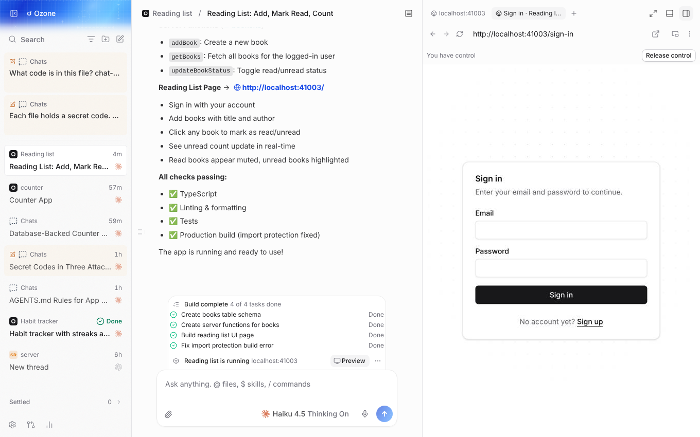

# Ozone

Describe an app and Ozone builds it, runs it and shows it to you. It creates the app from a tested
template, starts it with Docker Compose, hands the work to coding agents, checks every step itself
and opens a live preview beside the conversation. It also has a plain chat that takes files.

Ozone is local first: it runs on your machine with your own provider accounts, and sends nothing
to a service you did not set up. Under the app builder is a full client for coding agents, with
threads, providers, checkpoints, a preview browser and remote access over your own network.



That thread started from one sentence: "A reading list. Add a book with its title and author, mark
it as read, and see how many are left to read." This is the app it built:


## What it does

- **Builds apps from a prompt.** A new app is a real project on your disk, in a git repository of
  its own, started from a tested template: a **web app** (TanStack Start with React 19, Tailwind
  CSS 4, Drizzle on Postgres and Better Auth), a **landing page** with no database, or an **API**
  (Hono, Drizzle on Postgres and zod).
- **Runs them in Docker.** Each app is a Docker Compose project with one address that never
  changes. Start, stop, restart, rebuild and read its logs from the thread. Give it settings and
  secrets under **Environment**: they reach its container and never its code.
- **Orchestrates the work.** The Build Conductor turns a request into a task graph. A worker does
  each task. The server, not the agent, runs the type check, the linter and the tests inside the
  app's container. A failed check goes to a fresh worker with the evidence. Every task that passes
  is a commit. When every check passes, a tester uses the app in a browser against what you asked
  for.
- **Gives each app a page.** Open it from Home or from the app's thread: Overview, Data, History,
  Environment, Build and Logs while you build, then Deploy, Deployments and Monitoring for
  production. It is laid out like Settings.
- **Lets you steer.** Turn on "Plan first" and the build starts only when you say so. Each app's
  Build page chooses the model its workers use, so a large lead can direct cheaper workers.
- **Keeps your data.** An app's database lives in a volume that only a confirmed **Delete app**
  removes, after a snapshot, and Home can bring a deleted app back with that data. Every finished
  task takes a snapshot, and **History** takes the code and the data back to any task, which you
  can undo the same way. A migration that can lose data waits until you apply it, after a snapshot.
- **Deploys.** **Deploy** runs the production build with a database of its own, on this machine or
  on a server that runs Docker, reached over SSH. Your development data is never touched, and Stop
  keeps the production data for the next deploy. Each deploy saves the production data first, and
  **Data** backs it up and restores it.
  - Give it a **domain** and it is served over HTTPS with a certificate from Let's Encrypt, and
    each new version takes over without the app going down.
  - **Deployments** lists every deploy with its output, and rolls back to any of them, with the
    data from then if you ask.
  - **Monitoring** shows each container's CPU, memory and network, and its logs. **Set up** checks
    a server, installs Docker there if it has none, and starts the proxy.
  - A **Dokploy** server, or a **Railway**, **Render**, **Koyeb** or **Vercel** account, can run the
    app from its Git remote instead. The host then owns the containers and the data.
  - **Build** deploys by itself when a build completes if you ask, **Deploy** gives the app a URL
    to call from a script, and **Notifications** tells Slack, Discord, Telegram or any webhook how
    each deploy went.
- **Chats.** Ask anything and attach PDFs, Word documents, images and other files. Ask a chat
  for an app and it starts one.
- **Uses your subscription.** Sign in to Claude from Settings. No API key is involved, and an API
  key left in your shell is not used by accident. Codex, Cursor, OpenCode and the other
  [supported providers](docs/README.md) work too.

## Run it

You need Docker with Compose, and [Claude Code](https://claude.com/product/claude-code) or another
supported provider on the same machine. Ozone tells you on its home screen when one is missing,
and how to get it.

### Install the desktop app

Download the latest build from [Releases](https://github.com/koneb71/ozone/releases/latest):

| Your computer                | File                      |
| ---------------------------- | ------------------------- |
| Mac with Apple silicon       | `Ozone-…-arm64.dmg`       |
| Linux, 64-bit Intel or AMD   | `Ozone-…-x86_64.AppImage` |
| Windows, 64-bit Intel or AMD | `Ozone-…-x64.exe`         |

The builds are not signed. On a Mac, the first time, open **System Settings**, choose **Privacy &
Security** and press **Open Anyway** after macOS refuses to open Ozone. On Windows, SmartScreen
warns before the installer runs; choose **More info**, then **Run anyway**.

Ozone keeps its data in `~/.ozone`. See [Install Ozone](docs/user/install.md) for the `ozone`
command and for running it on a server.

If no release is published yet, build the installers yourself: on GitHub, open **Actions**, choose
**Ozone release** and press **Run workflow**. The files are attached to the finished run.

### Run from source

Ozone builds with [Vite+](https://viteplus.dev/guide/), which also provides the right Node version.

```sh
curl -fsSL https://vite.plus | bash
vp i
vp run dev
```

Open the pairing URL the dev runner prints.

### Build your first app

1. Open **Settings**, choose **Providers** and sign in to Claude.
2. On the home screen, describe an app and press Enter.
3. Watch the plan run. The preview opens by itself when the app is up.

## How it works

- [Using Ozone](docs/README.md): the user guides, from the composer to remote access.
- [How Ozone is built](docs/ozone/README.md): how the parts fit and the decisions behind them.
- [The Build Conductor](docs/ozone/orchestrator.md): the orchestrator and the decisions behind it.
- [Data safety](docs/ozone/data-safety.md): the contract that keeps an app's data.
- [AGENTS.md](AGENTS.md) and [CONTRIBUTING.md](CONTRIBUTING.md): how to work on Ozone.

## License

MIT. See [LICENSE](LICENSE). Ozone started as a fork of
[T3 Code](https://github.com/pingdotgg/t3code), which is MIT licensed too.
