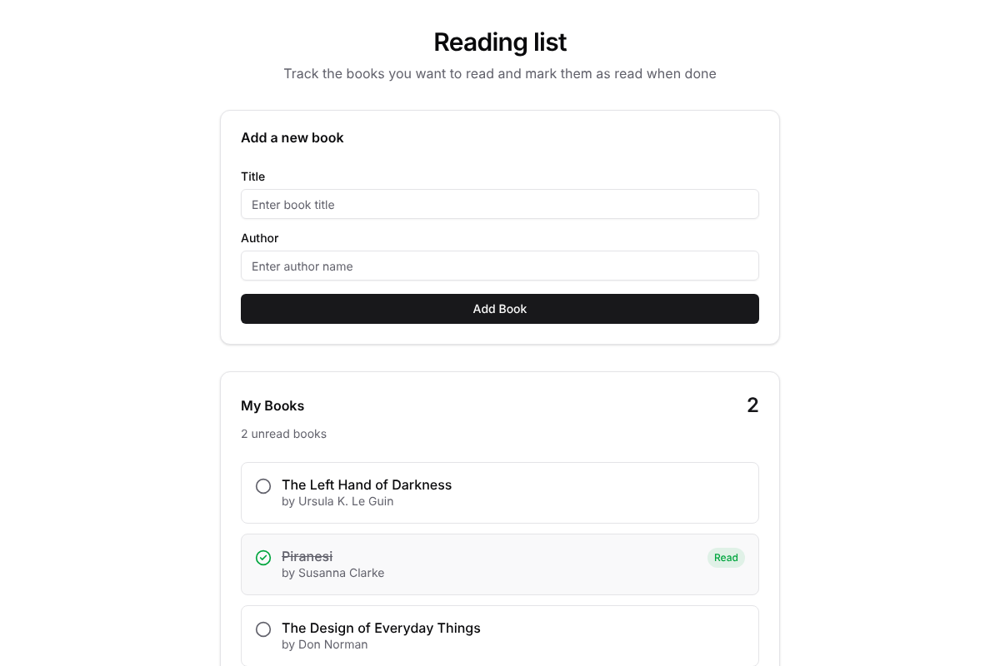

# Ozone

Describe an app and Ozone builds it, runs it and shows it to you. It creates the app from a tested
template, starts it with Docker Compose, hands the work to coding agents, checks every step itself
and opens a live preview beside the conversation. It also has a plain chat that takes files.

Ozone is a fork of [T3 Code](https://github.com/pingdotgg/t3code) and keeps everything T3 Code
does: threads, providers, checkpoints, the preview browser and remote access.


That thread started from one sentence: "A reading list. Add a book with its title and author, mark
it as read, and see how many are left to read." This is the app it built:



## What it does

- **Builds apps from a prompt.** A new app is a real project on your disk: TanStack Start with
  React 19, Tailwind CSS 4, Drizzle on Postgres and Better Auth, in a git repository of its own.
- **Runs them in Docker.** Each app is a Docker Compose project with one address that never
  changes. Start, stop, restart, rebuild and read its logs from the thread.
- **Orchestrates the work.** The Build Conductor turns a request into a task graph. A worker does
  each task. The server, not the agent, runs the type check, the linter and the tests inside the
  app's container. A failed check goes to a fresh worker with the evidence. Every task that passes
  is a commit.
- **Keeps your data.** An app's database lives in a volume that no Ozone code path can remove.
  Every finished task also takes a snapshot, and a snapshot can be restored from the app's menu.
  A migration that can lose data stops the build and asks.
- **Chats.** Ask anything and attach PDFs, Word documents, images and other files. Ask a chat
  for an app and it starts one.
- **Uses your subscription.** Sign in to Claude from Settings. No API key is involved, and an API
  key left in your shell is not used by accident. The other providers T3 Code supports work too.

## Run it

Ozone runs from source today. There are no installers or releases yet.

You need Docker with Compose, and [Claude Code](https://claude.com/product/claude-code) or another
supported provider installed on the same machine.

### Install `vp`

Ozone builds with [Vite+](https://viteplus.dev/guide/), which also provides the right Node version.

```sh
curl -fsSL https://vite.plus | bash
```

On Windows, in PowerShell:

```powershell
irm https://vite.plus/ps1 | iex
```

### Start it

```sh
vp i
vp run dev
```

Open the pairing URL the dev runner prints. Then:

1. Open **Settings**, choose **Providers** and sign in to Claude.
2. On the home screen, describe an app and press Enter.
3. Watch the plan run. The preview opens by itself when the app is up.

## How it works

Ozone's code lives in its own modules beside T3 Code's, and touches T3 Code's files only at small
tagged seams, so upstream changes keep merging.

- [Ozone and the fork](docs/ozone/README.md): how the parts fit, the fork rules, how to sync.
- [The Build Conductor](docs/ozone/orchestrator.md): the orchestrator and the decisions behind it.
- [Data safety](docs/ozone/data-safety.md): the contract that keeps an app's data.
- [Seams](docs/ozone/SEAMS.md): every upstream file Ozone edits, and why.

Everything else under [docs](docs/) is T3 Code's documentation, and it still applies.

## What is not Ozone yet

The mobile app, the desktop shell and many settings screens are T3 Code's and still carry its
name. Product telemetry and upstream's update checks are switched off.

## License

MIT, like T3 Code. See [LICENSE](LICENSE).
