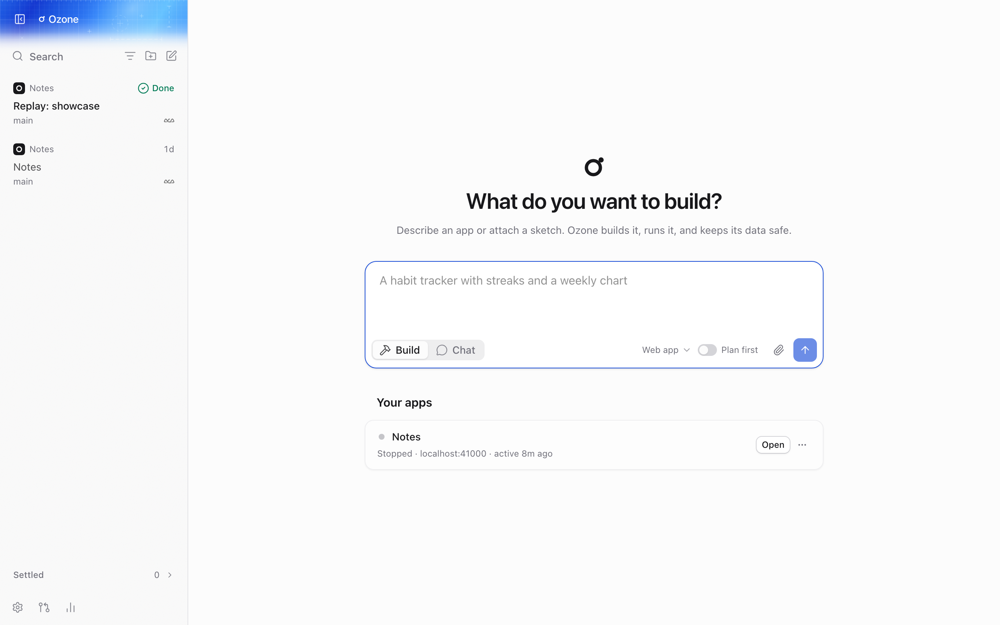

# Apps and builds

An app is a real project on your disk that Ozone creates from a template, runs with Docker
Compose and builds with coding agents. You describe what you want; Ozone plans the work, checks
each step itself and shows you the running app.

## Before you start

You need Docker with Compose running on the same machine, and one signed-in provider. Home says
so when either is missing.

## Create an app

1. On Home, choose **Build**.
2. Pick a template beside the message box:
   - **Web app**: pages, sign-in and a Postgres database.
   - **Landing page**: pages only, no database.
   - **API**: an HTTP API with a Postgres database.
3. To use a model other than your default, pick it beside the template.
4. Describe the app and press Enter. You can attach sketches or files.

The first time, Ozone asks where to keep your apps. Each app gets its own folder inside the one
you choose, on the machine Ozone's server runs on. To change it later, open **Settings →
Threads** and set **Apps are saved in**. Apps you already have stay where they are.

Ozone creates the project in a git repository of its own, starts its containers and opens a
thread where the build runs. The preview opens beside the thread when the app is up.

To see the plan before any work starts, turn on **Plan first**. With Claude, Codex, Cursor and
OpenCode the agent then runs in plan mode, where it cannot change anything: it reads the app, asks
you its questions on a card in the conversation, and shows its plan on a card with **View plan**,
**Approve**, **Keep planning** and **Decline**. Approve starts the build. Keep planning lets you
say what to change. Decline drops the plan.

Plan first applies to every request while it is on, including a small change to an app that is
already built. Approving a plan turns it off, so what you ask next is built straight away; turn
it on again when you want to see a plan first. The same switch sits above the message box in an
app's thread, and as **Show me the plan first** on the app's Build page.

To choose the look yourself, turn on **Pick the design** on Home (it is not offered for an API).
Before it plans, the agent offers three design directions above the message box, each drawn as a
small first screen in its own colours and faces, with its swatches, layout and mood. Pick one with
**Use**, or say what you want instead and it offers new ones. **Let the lead choose** leaves the
look to the agent and turns the setting off. Your pick is saved in the app's `DESIGN.md`, and later
changes follow it. To choose again, ask the agent for new directions or delete `DESIGN.md`. The
same switch is **Let me pick the design** on the app's Build page.

The previews never download fonts: a face that is not installed on your device shows in a similar
one. The app itself gets the real faces.

Antigravity, Fx, Grok, Kiro, Muse and Pi have no plan mode of their own. With those, Ozone asks
the agent to plan first: it files its plan as a task list, and no task runs until you select
**Start building** on that card. Nothing stops such an agent from editing a file while it plans,
so check its plan against what it did.

## What a build does

A lead agent turns your request into tasks. A worker agent does each task. After every task
Ozone itself runs the app's type check, linter and tests inside the app's container. A task that
fails goes to a fresh worker with the evidence. A task that passes becomes a commit and a
snapshot of the app's data.

When every task has passed, a tester can use the app in a browser against what you asked for,
on a phone-width screen and in dark and light too. Turn that on or off under **Build** on the
app's page.

Apps with pages are built with design and search guidance: agents follow the design skills in
the app's `.agents/skills` folder and Chrome's guidance for modern HTML and CSS, which Ozone
searches on your machine. Every page gets a title, a description and link-preview tags. A
landing page also gets `robots.txt` and a sitemap, and its final check fails when a page is
missing a title, a description, a single main heading, image descriptions, or its place in the
sitemap.

Ask for a change in the same thread to start another build on the same app.

## The app's page

Open it from Home, or from the app's status bar above the message box.

- **Overview**: the app's address and state, and start, stop, restart and rebuild.
- **Data**: snapshots of the app's database, and restoring one.
- **History**: every finished task. Go back to any of them, code and data together, and undo
  that the same way.
- **Environment**: settings and secrets for the app. They reach its container and never its code.
  A value for one place only, such as the server, goes on the Deploy page: see
  [Variables for one place](deploy.md#variables-for-one-place).
- **Build**: whether to show the plan first, whether you pick the design, whether a tester tries
  the finished app, which model the workers use, and whether to deploy when a build completes.
- **Logs**: what the app's containers print.
- **Deploy**, **Deployments**, **Monitoring**: see [Deploying an app](./deploy.md).

## Your data is kept

An app's database lives in a Docker volume that only **Delete app** removes, and only after a
snapshot. Home can bring a deleted app back with that data.

A migration that could lose data does not run by itself. Ozone shows you its statements and waits
until you apply it, after taking a snapshot.

## Chats

Choose **Chat** on Home for a plain conversation that takes files. Ask a chat for an app and it
starts one.
