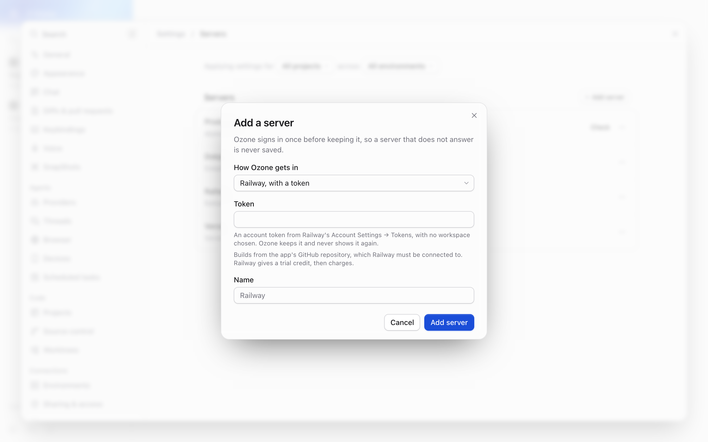

# Deploying an app

**Deploy** on an app's page runs the app's production build where people can reach it. Production
has a database of its own, so your development data is never touched.

## Where an app can run

| Where                  | Who runs the containers | What you need                             |
| ---------------------- | ----------------------- | ----------------------------------------- |
| This computer          | Ozone                   | Docker                                    |
| A server over SSH      | Ozone                   | A Linux server you can sign in to         |
| Dokploy                | Dokploy                 | Your Dokploy address and an API key       |
| Railway, Render, Koyeb | The host                | A token from the host, and a GitHub repo  |
| Vercel                 | Vercel                  | A token. Only for apps without a database |

When Ozone runs the containers you get the most: snapshots before every deploy, rollback to any
earlier deploy, a domain with HTTPS, monitoring, and moving the data when you change servers.

When Dokploy or a hosting platform runs the app, it owns the containers and the data. Snapshots,
rollback and monitoring stay with that host, and Ozone never deletes anything there.

## Add a server

Servers are added once and offered to every app. Open **Settings**, then **Servers**, or
**Servers** on any app's page, and choose **Add server**.

- **This computer's SSH keys**: for a server that `ssh user@host` already signs in to.
- **Paste Ozone's key on it**: Ozone shows one command to run on the server, which lets its own
  key in.
- **Sign in with a password once**: Ozone uses the password to install its key and then forgets
  it.
- **Dokploy, with an API key**: from Dokploy's Settings, Profile, API/CLI.
- **Railway, Render, Koyeb, Vercel**: a token from that host's account settings. The dialog says
  where to find it.

Ozone signs in once before saving, so a server that does not answer is never saved. Keys and
tokens stay on your machine and are never shown again.

For an SSH server, **Set up** on the Deploy page checks it, installs Docker if it has none and
starts the proxy that serves domains.

## Deploy

The Deploy button appears once the app has started successfully for the first time. Before
that there is nothing to deploy.

1. Open the app's page and choose **Deploy**.
2. Choose **This computer** or **A server**, and pick the server.
3. Optionally give a domain. Point it at the server first. Ozone serves it over HTTPS and swaps
   in each new version without the app going down. On a hosting platform, set the domain up
   there.
4. Press **Deploy**.

The same button sits at the top of the app's page, whichever section you are in. It reads
**Deploy** until the app is deployed, **Push update** when the app has changes production does
not have yet, and **Deploy again** when production is current. Pushing an update sends the
newest commit to where the app already runs. To move it somewhere else, change **Where it runs**
on the Deploy page and press **Deploy here instead**.

Each deploy builds the app's last commit, applies its database migrations and starts it. A
migration that could lose data is held back until you apply it. On Dokploy and hosting platforms
Ozone cannot take a snapshot first, so apply such a migration on the host.

## Hosts that build from a Git repository

Dokploy, Railway, Render and Koyeb build the app from a Git repository, and a new app has none.
The Deploy page says so before you deploy and offers **Create repository**: pick private or
public, and Ozone creates the GitHub repository, makes it the app's origin and pushes. Sign in to
GitHub under **Settings**, **Source control** first.

- **Dokploy** cannot read a private repository by itself. Ozone gives it a read-only key for the
  repository, using the `gh` command line's sign-in. Without that, the deploy stops and shows the
  key to add under the repository's deploy keys.
- **Railway** and **Koyeb** need their GitHub app connected to the repository in their own
  dashboard. **Render** needs that for a private repository.

## What the free plans do

- **Railway** gives a trial credit, then charges.
- **Render** puts a free app to sleep when idle and deletes a free database after about a month.
- **Koyeb** allows one free app and one small free database, and asks for a card.

## After the first deploy

- **Deployments** lists every deploy with its output. When Ozone runs the containers, roll back
  to any of them, with the data from then if you ask.
- **Monitoring** shows each container's CPU, memory, network and logs when Ozone runs them.
- **Stop production** takes the app offline and keeps its data for the next deploy.
- **Deploy from a script** gives the app a URL that redeploys it when called.
- **Notifications** tells Slack, Discord, Telegram or any webhook how each deploy went.
- **Build** can deploy by itself whenever a build completes.
